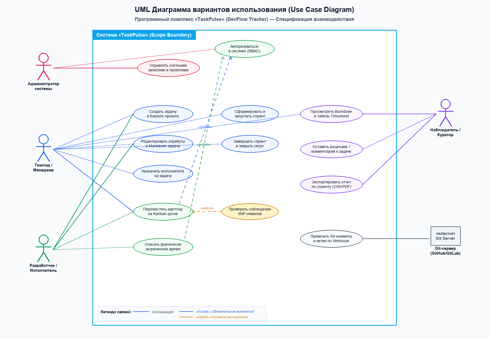

# TaskPulse (DevFlow Tracker) ⚡

> **Легковесная система контроля и распределения задач для командной разработки (Lightweight Issue Tracker / Kanban)**  
> Проект разрабатывается в рамках производственной / учебной практики по специальности **09.02.07 «Информационные системы и программирование»** (группа ИСП 431).  
> **Автор:** Коновалов П.С.  
> **Руководитель практики:** Роман Владимирович  

[](LICENSE)
[](#)
[](#)
[](#)

---

## 📌 О проекте

**TaskPulse** — это специализированная веб-система оперативного управления задачами и спринтами, спроектированная как высокопроизводительный и эргономичный аналог *Linear* и *Jira* для небольших IT-команд (3–10 разработчиков), студенческих проектных объединений и инди-студий.

### Проблема, которую решает продукт:
В коллективной разработке ПО ключевым узким местом выступает **информационная фрагментация**: задачи ведутся в громоздких или разрозненных трекерах (Jira, Trello), обсуждение идет в мессенджерах (Telegram, Discord), а фиксация кода — в Git-серверах (GitHub, GitLab). Возникает рассинхрон между требованиями, кодом и трудозатратами. Существующие корпоративные ALM-системы перегружены (Overengineering), требуют 4–8 ГБ памяти под JVM и заблокированы санкциями.

### Цели разработки:
* Создание легковесного автономного веб-трекера задач с потреблением RAM до 200–512 МБ в Docker.
* Обеспечение сквозной трассируемости: **«Задача ↔ Git-коммит ↔ Списанное время»**.
* Внедрение наглядного контроля нагрузки: интерактивный Kanban с WIP-лимитами, Burndown-диаграммы и табели Timesheet.

---

## 👥 Роли пользователей (RBAC)

1. 👑 **Администратор системы (System Administrator):** Управление аккаунтами пользователей, проектами, системными токенами Git и аудитом безопасности.
2. 🎯 **Тимлид / Менеджер проекта (Team Lead / PM):** Планирование и запуск спринтов, приоритеты бэклога, распределение исполнителей, аналитика Burndown и Timesheet, контроль WIP-лимитов.
3. 💻 **Разработчик / Исполнитель (Developer):** Создание тикетов, смена статусов на Kanban-доске, списание затраченных часов (Worklog), связка веток и коммитов.
4. 👁️ **Наблюдатель / Куратор (Observer / Mentor):** Режим «только чтение», аудит успеваемости, просмотр графиков сгорания задач, выгрузка сводных отчетов.

---

## 📐 Архитектура требований (FR & NFR)

### Функциональные требования (FR-01 .. FR-12):
* **FR-01 — FR-02:** Регистрация, профили, безопасная аутентификация и RBAC-авторизация (HttpOnly Cookie, Argon2id/bcrypt).
* **FR-03 — FR-04:** Управление бэклогом, Markdown-описание, приоритеты (`Critical`–`Low`), декомпозиция на подзадачи.
* **FR-05 — FR-06:** Интерактивная Kanban-доска (Optimistic Drag-and-Drop) и назначение исполнителей.
* **FR-07:** Модуль оперативного учета трудозатрат (Time Logging) с автопересчетом `time_spent` и `time_remaining`.
* **FR-08:** Управление спринтами: фиксация емкости команды (Capacity), целей (Sprint Goal), старт и завершение итераций.
* **FR-09:** Git Webhook интеграция (автоматическое связывание коммитов и веток по ключу `TP-XXX`).
* **FR-10:** Быстрые фильтры («Мои задачи», по спринту, приоритету) и полнотекстовый поиск.
* **FR-11:** Аналитика спринтов: график сгорания задач (Burndown Chart) и сводный табель Timesheet.
* **FR-12:** Автоматический контроль ограничений незавершенного производства (WIP Limits).

### Нефункциональные требования (NFR-01 .. NFR-10):
* **Производительность:** Время отклика API < 200 мс (p95), рендеринг доски < 500 мс.
* **Безопасность:** Защита от OWASP Top 10, криптография Argon2id, сессии HttpOnly/SameSite, zero-leak secrets.
* **Надежность и масштабируемость:** ACID-транзакции, до 50 активных пользователей и 10 000 задач на проект.
* **Автономность:** Развертывание в Docker Compose одной командой без сторонних SaaS-сервисов.

---

## 📊 UML Диаграмма вариантов использования (Use Case)

Спецификация взаимодействия акторов и системы представлена на диаграмме:



Полный PlantUML-код и детальное описание сценариев доступны в документе:  
👉 **[docs/use-case.md](docs/use-case.md)**

---

## 🛠 Технологический стек

* **Frontend:** React 18, TypeScript, Tailwind CSS, Lucide Icons, Drag-and-Drop Context (Optimistic UI).
* **Backend:** Node.js (Fastify/Express) / Python (FastAPI), REST API, Webhook Engine.
* **База данных:** PostgreSQL 16 (реляционная модель с каскадным удалением) / SQLite (для портативного запуска).
* **Архитектурный стандарт:** Everything Claude Code (ECC) — строгая иммутабельность, контракты данных, модульность (<800 строк/файл), TDD-покрытие тестами $\ge 80\%$ (факт: **99%**).
* **Инфраструктура:** Docker, Docker Compose.

---

## 📂 Структура проекта

```text
taskpulse-tracker/
├── docs/                                  # Проектная документация и отчеты
│   ├── Day1_Concept_MVP.docx              # Официальный отчет за День 1
│   ├── Day2_Requirements_UseCase.docx     # Официальный отчет за День 2
│   ├── requirements.md                    # Спецификация FR и NFR требований
│   ├── use-case.md                        # Сценарии и PlantUML код диаграммы
│   └── use-case-diagram.png               # Векторное графическое изображение Use Case
├── src/                                   # Исходный код программного комплекса
│   ├── client/                            # Веб-клиент (Frontend)
│   │   ├── components/                    # UI-компоненты (Kanban, модалки, тайм-трекер)
│   │   ├── pages/                         # Страницы (Доска, Бэклог, Аналитика)
│   │   ├── services/                      # API-клиенты и сетевые сервисы
│   │   └── types/                         # TypeScript-интерфейсы и типы данных
│   ├── server/                            # Серверная часть (Backend API)
│   │   ├── api/                           # Маршруты и контроллеры REST API
│   │   ├── middleware/                    # Аутентификация, RBAC и валидаторы
│   │   ├── services/                      # Бизнес-логика задач и спринтов
│   │   └── webhooks/                      # Обработчик вебхуков Git (GitHub/GitLab)
│   └── domain/                            # Доменная модель и контракты данных (SSOT)
│       ├── __init__.py
│       └── contracts.py                   # Иммутабельные сущности (frozen dataclass)
├── tests/                                 # Набор автоматических тестов
│   ├── __init__.py
│   └── test_domain_contracts.py           # Unit-тесты доменной логики (99% coverage)
├── .gitignore                             # Правила исключений Git (усилено DevSecOps)
├── docker-compose.yml                     # Сценарий оркестрации контейнеров
└── README.md                              # Главный файл документации репозитория
```

---

## 📅 Дорожная карта практики

- [x] **День 1:** Выбор темы, анализ предметной области, роли участников, спецификация MVP (MoSCoW), инициализация Git-репозитория.
- [x] **День 2:** Формализация функциональных (FR-01..FR-12) и нефункциональных требований (NFR-01..NFR-10), построение UML Use Case диаграммы, описание сценариев, организация структуры проекта.
- [ ] **День 3:** Проектирование схемы реляционной базы данных (ER-диаграмма), миграции, REST API контракты и авторизация.
- [ ] **День 4:** Разработка пользовательского интерфейса (Kanban-доска, Optimistic Drag-and-Drop, таймер списания часов).
- [ ] **День 5:** Интеграция Git-вебхуков, аналитические дашборды (Burndown, Timesheet), итоговая сборка и тестирование.

---

## 📄 Лицензия
Проект распространяется под свободной лицензией MIT.
