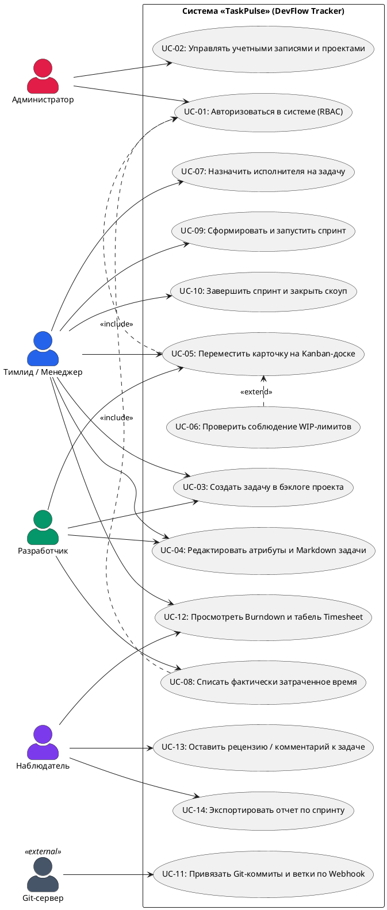

# Спецификация Use Case диаграммы и сценариев использования

## 1. PlantUML исходный код диаграммы вариантов использования

---

## 2. Детальное описание 3 основных сценариев использования

### Сценарий №1. Создание и декомпозиция задачи в бэклоге проекта
* **Название:** Регистрация новой функциональной задачи и декомпозиция на подзадачи.
* **Основной актор:** Тимлид / Менеджер проекта (вторичный актор — Разработчик).
* **Предусловия:**
  1. Пользователь авторизован в системе с ролью `TEAM_LEAD` или `DEVELOPER`.
  2. В системе существует активный проект, в котором пользователь состоит в качестве участника.
* **Основной поток выполнения (Main Flow):**
  1. Пользователь нажимает кнопку «Создать задачу» (или нажимает горячую клавишу `C` на клавиатуре).
  2. Система открывает модальное окно создания тикета.
  3. Пользователь заполняет поля формы:
     * Краткое наименование: например, «Разработка модуля авторизации JWT»;
     * Подробное описание в формате Markdown (с описанием API и шагов);
     * Тип задачи: `Feature`;
     * Приоритет: `High`;
     * Предварительная оценка трудоемкости: `8` часов;
     * Критерии приемки (Definition of Done).
  4. Пользователь нажимает кнопку «Сохранить».
  5. Система выполняет валидацию введенных данных.
  6. Система генерирует уникальный ключ тикета (формат: `TP-105`), вычисляет `remaining_minutes = 480` и сохраняет задачу в базе данных со статусом `BACKLOG`.
  7. Тимлид открывает созданную карточку и добавляет две подзадачи (Subtasks): «Генерация секретов и токенов» и «Middleware валидации».
  8. Система отображает созданную задачу и ее иерархию в общем списке бэклога.
* **Альтернативные потоки (Alternative Flows):**
  * **3а. Обязательные поля не заполнены:**
    1. Система подсвечивает поле «Заголовок» красным цветом и выводит сообщение: «Поле обязательно для заполнения».
    2. Задача не сохраняется в БД. Пользователь исправляет ввод и повторяет шаг 4.
  * **5а. Отрицательная или некорректная оценка времени:**
    1. Система выводит предупреждение: «Оценка трудоемкости должна быть положительным числом часов».
    2. Фокус возвращается на поле оценки.
* **Постусловия:** Задача зарегистрирована в реляционной БД со статусом `BACKLOG` и доступна для приоритизации, поиска и включения в спринт.

---

### Сценарий №2. Перемещение карточки на Kanban-доске и списание затраченного времени
* **Название:** Выполнение задачи разработчиком, смена статуса и внесение трудозатрат (Time Logging).
* **Основной актор:** Разработчик / Исполнитель.
* **Предусловия:**
  1. Разработчик авторизован под ролью `DEVELOPER`.
  2. Задача назначена на данного разработчика и находится в колонке `To Do` активного спринта.
* **Основной поток выполнения (Main Flow):**
  1. Разработчик открывает страницу «Активный спринт (Kanban-доска)».
  2. Разработчик захватывает карточку задачи (например, `TP-105`) курсором мыши и перетаскивает ее из колонки `To Do` в колонку `In Progress`.
  3. Система проверяет WIP-лимит колонки `In Progress`. Лимит не превышен.
  4. Система выполняет оптимистичное обновление интерфейса (Optimistic UI) и асинхронно отправляет запрос `PATCH /api/v1/tasks/TP-105/status` с телом `{"status": "IN_PROGRESS"}`.
  5. Статус задачи в базе данных обновляется, фиксируется временная метка начала работы.
  6. Разработчик выполняет написание программного кода.
  7. По завершении рабочего интервала разработчик кликает по карточке и нажимает кнопку «Списать время» (Log Work).
  8. Разработчик указывает затраченное время (`2h 30m`) и комментарий: «Реализован базовый контроллер генерации JWT».
  9. Пользователь нажимает «Подтвердить».
  10. Система валидирует данные, создает запись в таблице `worklogs`, пересчитывает поля: `spent_minutes` увеличивается на 150, `remaining_minutes` уменьшается на 150 (с 480 до 330 мин).
  11. Карточка на доске мгновенно отображает обновленный прогресс-бар списанных часов.
* **Альтернативные потоки (Alternative Flows):**
  * **3а. Превышен установленный WIP-лимит колонки (точка расширения «extend»):**
    1. Система обнаруживает, что число задач в колонке `In Progress` равно или превышает заданный лимит тимлида.
    2. Система выводит диалоговое окно предупреждения: «Внимание: превышен лимит незавершенного производства (WIP Limit)! Завершите текущие задачи перед взятием новых».
    3. Разработчик подтверждает перенос с фиксацией нарушения в логе аудита либо отменяет действие (карточка возвращается в `To Do`).
  * **8а. Пользователь указывает длительность списания 0 или некорректный формат:**
    1. Система блокирует кнопку подтверждения и выводит подсказку: «Укажите время в формате 1h 30m или число минут».
* **Постусловия:** Статус задачи актуализирован в БД; запись о списании времени добавлена в аудит; пересчитана общая трудоемкость спринта.

---

### Сценарий №3. Планирование, балансировка и запуск спринта
* **Название:** Формирование пула задач и старт итерации разработки (Sprint Planning).
* **Основной актор:** Тимлид / Менеджер проекта.
* **Предусловия:**
  1. Пользователь авторизован с ролью `TEAM_LEAD`.
  2. В бэклоге проекта имеются оцененные задачи со статусом `BACKLOG`.
  3. В проекте отсутствуют другие активные незавершенные спринты (ограничение методологии).
* **Основной поток выполнения (Main Flow):**
  1. Тимлид переходит в раздел «Планирование спринтов».
  2. Тимлид нажимает кнопку «Создать спринт».
  3. Заполняются параметры спринта:
     * Название: «Спринт 1: Ядро системы и авторизация»;
     * Цель спринта (Sprint Goal): «Реализовать регистрацию, вход и базовую доску задач»;
     * Дата начала: текущая дата;
     * Дата окончания: текущая дата + 14 календарных дней (двухнедельная итерация).
  4. Система рассчитывает общую емкость команды (Capacity) на основе суммарных доступных часов участников (например, 3 разработчика $\times$ 40 ч = 120 часов).
  5. Тимлид перетаскивает задачи из списка Бэклога в область создаваемого спринта.
  6. При добавлении каждой задачи система суммирует плановые часы и сопоставляет с Capacity. Индикатор загрузки отображает 95 часов из 120 (безопасный уровень нагрузки).
  7. Тимлид назначает ответственных исполнителей на добавленные задачи.
  8. Тимлид нажимает кнопку «Запустить спринт».
  9. Система меняет статус спринта на `ACTIVE`, переводит все включенные задачи из статуса `BACKLOG` в статус `TO_DO`, фиксирует начальный скоуп (Sprint Baseline) для построения диаграммы сгорания (Burndown Chart).
  10. Система перенаправляет тимлида на активную Kanban-доску спринта.
* **Альтернативные потоки (Alternative Flows):**
  * **6а. Суммарная трудоемкость задач превышает емкость команды (Overcommitment):**
    1. Индикатор загрузки окрашивается в тревожный красный цвет (например, 145 часов из 120).
    2. Система выводит предупреждение: «Трудоемкость скоупа превышает емкость команды на 25 часов. Рекомендуется исключить второстепенные задачи».
    3. Тимлид убирает наименее приоритетные задачи обратно в бэклог перед запуском.
  * **9а. Попытка запустить спринт без единой задачи:**
    1. Система блокирует запуск с сообщением: «Невозможно запустить пустой спринт. Добавьте хотя бы одну задачу».
* **Постусловия:** Спринт переведен в состояние `ACTIVE`; зафиксирован базовый график Burndown; задачи доступны разработчикам на доске в колонке `To Do`.
